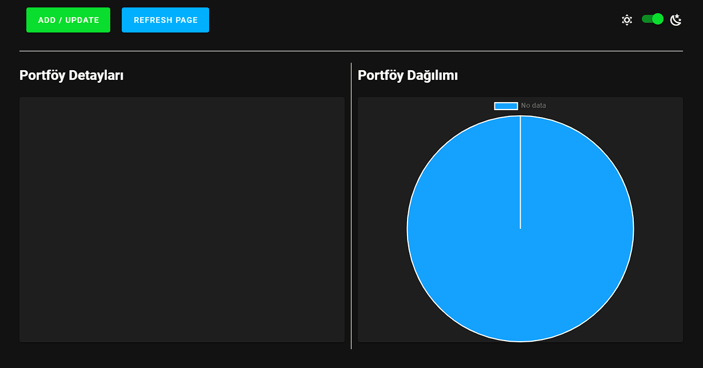
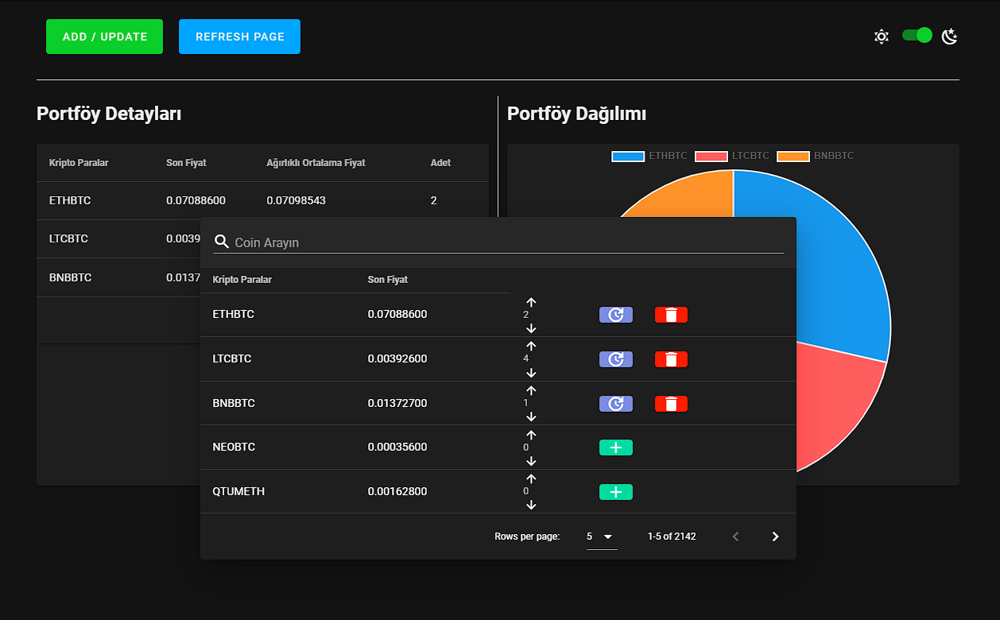
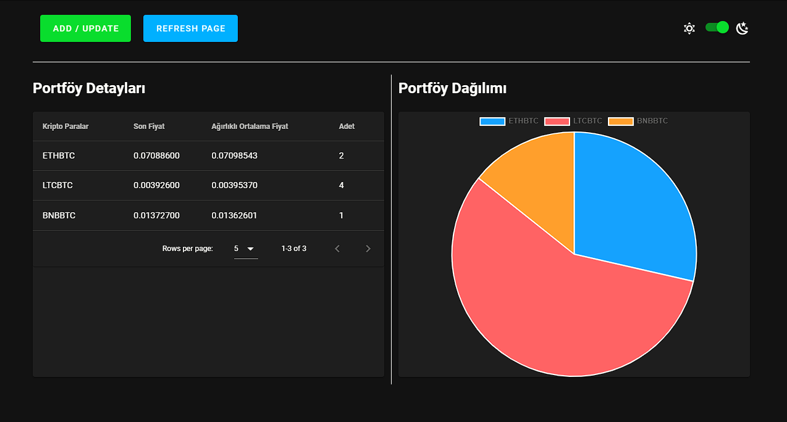
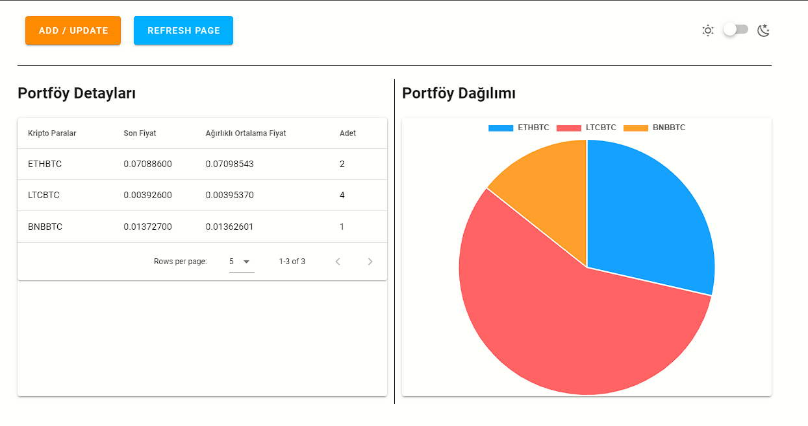

# Coin Portfolio

A Vue.js app for tracking a crypto portfolio. Pick coins from live Binance market data, add them to your portfolio, and see the distribution in a pie chart.

## Features

- Live prices from the Binance 24hr ticker API
- Add and remove coins through a modal
- Portfolio table with last price, weighted average price and quantity
- Pie chart of the portfolio distribution
- Light and dark mode
- Data refreshes automatically every 20 minutes

## Tech Stack

- Vue 2
- Vuex
- Vuetify 2
- Chart.js with vue-chartjs
- Axios
- Binance API: https://api2.binance.com/api/v3/ticker/24hr

## Screenshots

## Getting Started

npm install
npm run serve

## Build

npm run build

## Have a look at [Netlify](https://thunderous-trifle-7e60a3.netlify.app)

## Project Images

### Customize configuration
See [Configuration Reference](https://cli.vuejs.org/config/).
